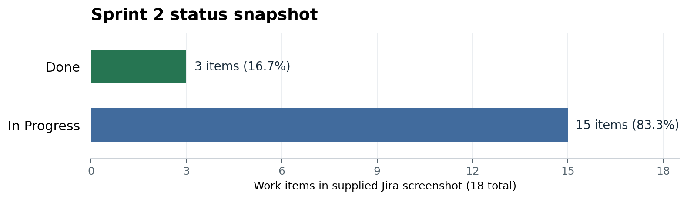

::: {custom-style="Title"}
COS30049 COMPUTING TECHNOLOGY INNOVATION PROJECT

Sprint 2 Report
:::

**Smart Ground-Truthing and Digital Biodiversity System for Plant Species Documentation**

**Group 10**  
**Planned sprint period:** 13 October–5 November 2026  
**Reporting date:** 4 November 2026  
**Document status:** Review draft; the planned sprint has not yet ended.

| Group member | Student ID |
|:--|:--|
| Stanton Qi Jin Choo | 104391591 |
| Angie Ang Chyi Yee | 104394710 |
| Jia Sin Ung | 104395250 |
| Jia Ning Chen | 104391287 |
| Jia Xuan Kee | 104395577 |
| Jason Pangestu | 104404033 |
| Yu Xi Phuan | 104383093 |

**Basis of this report.** This draft compares the supplied Sprint 1 CTIP report with the current local workspace, repository history, the supplied Jira screenshot and diagnostic evidence available on 4 November. Jira statuses are transcribed from that screenshot; they have not been changed. Source code demonstrates implementation, while automated tests and runtime observations provide narrower evidence of behaviour. An implementation is not treated as a completed field evaluation. Proposed actions and acceptance checks are identified explicitly.

```{=openxml}
<w:p><w:r><w:br w:type="page"/></w:r></w:p>
```

# Executive overview

Sprint 1 established the mobile and web prototypes, database design, security workflows and initial AI/IoT demonstrations. Its main limitation was incomplete cloud and database integration. Sprint 2 shifted the emphasis toward shared PostgreSQL storage, authenticated APIs, mobile connectivity and integration testing.

The current workspace contains substantial changes: PostgreSQL-backed account services and plant APIs; a mobile plant-submission flow that saves plant details, photographs, GPS and QR assignment through one server request; offline field-storage and synchronisation components; a separate BioCLIP 2 image-retrieval prototype; and a camera rule that combines sustained wrist proximity with movement of the contacted plant. Account inactivity management and translation have also been added. These changes move the project beyond the standalone demonstrations described in Sprint 1.

The complete system cannot yet be reported as accepted. The supplied Sprint 2 board contains **18 items: 3 Done and 15 In Progress**. Important gaps remain in observation submission, officer review persistence, cloud sensor ingestion, browser camera integration, AI evaluation and final usability testing. The report therefore records the increment as an integration-stage prototype with working components and outstanding acceptance work.

# 1. Sprint #2 Plan

## 1.1 Sprint goal

The Sprint 2 goal, reflected in the Jira description “Complete Database, Intergration and Testing”, was to connect the prototypes to shared storage and demonstrate the main plant-documentation workflow across the mobile application, backend and website. The intended workflow is: an authorised botanist collects a plant record and supporting evidence; the server validates and stores it; a conservation officer reviews it; and approved information becomes available according to user permissions.

Supporting work includes environmental sensor collection, duplicate-candidate retrieval, biometric access, translation, account lifecycle controls and testing. The sprint goal remains a target until the connected workflow and its failure cases have been demonstrated.

## 1.2 User roles

| Role | Responsibility carried forward from Sprint 1 |
|:--|:--|
| Botanist | Collect plant details, photographs and GPS; submit records and subsequent observations. |
| Conservation Officer | Review scientific information, manage authorised biodiversity records and assess monitoring alerts. |
| Administrator | Manage accounts, roles, activation and suspension. |
| Visitor | Access approved educational and QR-linked plant information under the relevant permissions. |

Account administration and scientific approval remain separate responsibilities. AI similarity results and camera alerts support human review; neither result automatically confirms a duplicate plant or illegal activity.

## 1.3 Backlog selection and changes from Sprint 1

The selected backlog prioritises dependencies that prevented the earlier prototypes from operating as a connected system. Database-backed submission and field validation support reliable records. Cloud synchronisation and mobile/backend integration support continuity between field collection and officer access. Dataset preparation and AI evaluation support responsible interpretation of the AI outputs.

The Sprint 1 report listed 30 items in its review, whereas the supplied current screenshot shows 29 items under Sprint 1. Duplicate detection, SCRUM-213, now appears in Sprint 2. This explains the one-item difference without implying that a task was completed or removed from the project.

The Sprint 2 list comprises eight carryovers identified in the earlier report (SCRUM-16, 22, 28, 29, 211, 218, 219 and 220), transferred duplicate-detection work (213), five integration/evaluation items (25, 26, 27, 32 and 34), and four additional activities (234–237). No new story-point or business-value estimates have been invented for this report.

## 1.4 Sprint 2 backlog and recorded status

Table 1 follows the supplied Jira screenshot. Names are expanded where the screenshot initials and Sprint 1 responsibility allocation identify the member. Unassigned items remain unassigned; the sensor lead is taken from Sprint 1 because the screenshot shows an avatar rather than readable initials.

| Jira key | Work item | Screenshot status | Recorded owner / source |
|:--|:--|:--|:--|
| SCRUM-213 | Implement duplicate plant detection | In Progress | Stanton |
| SCRUM-29 | Validate and organise species reference dataset | In Progress | Stanton |
| SCRUM-28 | Collect and prepare plant identification dataset | In Progress | Stanton |
| SCRUM-22 | Environmental sensor collection | Done | Jason, Sprint 1 lead |
| SCRUM-211 | Implement field-data validation | In Progress | Jia Sin |
| SCRUM-16 | Cloud synchronisation | In Progress | Angie |
| SCRUM-219 | Conduct functional testing and fix issues | In Progress | Angie |
| SCRUM-218 | Integrate mobile application, backend and database | In Progress | Jia Ning |
| SCRUM-220 | Demonstrate the completed prototype | In Progress | Unassigned |
| SCRUM-25 | System integration testing | In Progress | Unassigned |
| SCRUM-26 | Usability testing | In Progress | Unassigned |
| SCRUM-32 | Implement offline AI-assisted identification interface | In Progress | Unassigned |
| SCRUM-34 | Evaluate AI identification performance and field usability | In Progress | Unassigned |
| SCRUM-27 | Final integration and testing | In Progress | Unassigned |
| SCRUM-234 | Biometrics | In Progress | Unassigned |
| SCRUM-235 | Auto detect prototype | In Progress | Unassigned |
| SCRUM-236 | Account inactivity management | Done | Unassigned |
| SCRUM-237 | Translation | Done | Angie |

*Table 1. Sprint 2 backlog transcribed from the supplied Jira screenshot.*

## 1.5 Module work breakdown and responsibilities

| Module | Sprint 2 work | Coordination responsibility |
|:--|:--|:--|
| Mobile field collection | Connect submission, photographs, QR, GPS and offline records to authenticated APIs. | Jia Ning, with backend support. |
| Website | Present shared records and connect officer decisions, species management and reports. | Jia Sin. |
| Database | Support relational storage, schema compatibility, migrations and recovery. | Jia Xuan, coordinating with API owners. |
| Cloud and integration | Configure shared endpoints, connectivity and functional checks. | Angie, coordinating cross-module work. |
| AI | Develop duplicate-candidate retrieval, reference data and camera behaviour. | Stanton. |
| IoT | Collect sensor data and connect the device upload path. | Jason, with Stanton for camera/sensor correlation. |
| Cybersecurity | Maintain server authentication, permissions, account lifecycle and biometric integration. | Yu Xi. |

*Table 2. Coordination areas carried forward from Sprint 1; this table does not assign Jira items that are currently unassigned.*

## 1.6 Timeline and planned acceptance

The board defines 13 October–5 November as the sprint period. Repository commits from 27 October onward show offline-field, API, RBAC, IoT, account-storage and mobile-connectivity changes. The 31 October history includes PostgreSQL Face ID integration, and 2–4 November includes account and botanist-workflow updates. These dates establish development activity, not the date on which every feature passed acceptance. The workspace also contains local, uncommitted AI work.

Before closing the sprint, the team should demonstrate one complete record from mobile submission to persistent officer approval and authorised public display; a durable offline-save/retry cycle; a sensor upload appearing in the same website data source; and documented AI/biometric limitations. The final review and retrospective should be updated after the planned 5 November end date. No final review meeting or stakeholder sign-off is asserted in this draft.

# 2. Sprint #2 Review Report

## 2.1 What changed since Sprint 1

| Area | Sprint 1 baseline | Current Sprint 2 finding |
|:--|:--|:--|
| Shared storage | Database structure designed; cloud/database integration unfinished. | PostgreSQL-backed account and plant services exist. Domain, account and face storage use separate configured schemas. Some legacy and newer data paths still differ. |
| Authentication and RBAC | Login, recovery and role-management prototypes; browser/local data featured in the earlier report. | Server-side password verification, sessions, role checks, activation and suspension are implemented. Current password creation uses scrypt, rather than the earlier proposed bcrypt design. |
| Plant registration | Mobile form, photographs, GPS and QR demonstrated as prototype functions. | Add Plant calls a transactional submission endpoint with photos, GPS, QR assignment and retry protection. Device-to-database acceptance is still required. |
| Observations and officer review | Prototype observation and approval interfaces. | Persistent APIs have expanded, but Add Observation still uses mock data and the inspected review buttons show unsaved-feedback behaviour rather than persisting decisions. |
| Offline workflow | Offline capture and synchronisation incomplete. | Separate field-collection, local storage and synchronisation components exist. Coverage across the main screens and restart/retry scenarios remains to be accepted. |
| AI duplicate candidates | Original CLIP similarity/indexing prototype and demonstration scores. | A separate BioCLIP 2 application adds biology-focused embeddings, ranked top-five retrieval, recursive reference scanning and cached vectors. It is not yet a database duplicate-prevention service. |
| Camera monitoring | Person/plant-region interaction prototype and local video evidence. | Human detection, plant detection, wrist pose and optical flow are combined; alerts require sustained wrist proximity plus movement of that plant. Fixed-region selection remains a desktop control. |
| IoT | Physical sensor prototype; backend/cloud transmission unfinished. | Sensor collection is marked Done. A serial-to-HTTP uploader with a durable retry outbox exists, but stored cloud readings and the website route alignment remain outstanding. |
| Biometrics | Not a completed integrated deliverable in the earlier baseline. | Face/account integration and PostgreSQL face storage exist. Windows path issues were investigated; a complete successful user login and usability evaluation still require evidence. |
| Account lifecycle and language | Limited lifecycle and multilingual coverage in the earlier prototype report. | Thirty-day inactivity handling and English/Bahasa Melayu mobile translation are implemented and marked Done in Jira. |

*Table 3. Changes supported by the earlier report, current source and available diagnostic evidence.*

## 2.2 Database, API and mobile integration

The main advance is the transition from interface demonstrations toward shared persistent services. The current backend exposes plant, observation, species-request, record-change, version-history, media and device routes with permission checks. Account and biometric services are maintained separately from plant-domain storage.

The latest Add Plant screen calls `POST /api/plant-submissions`. The server validates the payload, checks the QR inventory and writes related records in a transaction. This includes the plant, GPS location, initial pending observation, photographs and, when required, a proposed species. A client key and stored receipt protect identical retries from creating duplicate submissions. Invalid photos, unavailable QR codes and transaction failures are rejected rather than being reported as successful saves. This is a material improvement over the earlier in-memory plant-registration finding.

Integration remains uneven. Add Observation still imports and writes through the local mock-data module. In the inspected officer Review Submissions view, approval/rejection actions currently display feedback that the decision has not been saved. Some species-management and reporting views still use the conservation data store. API availability therefore does not establish that every visible screen reads and writes the same persistent records.

The offline field-collection path includes capture, durable storage and synchronisation utilities. It should be demonstrated separately from the online Add Plant screen. Acceptance requires closing and reopening the app without connectivity, retaining photos and metadata, reconnecting, and confirming one server record after repeated retries. The complete offline workflow remains In Progress in the board evidence.

## 2.3 Cloud connectivity and runtime setup

The development architecture uses a Vue website, an Expo/React Native mobile app, Node services, PostgreSQL, and Python AI/face components. A local gateway and Cloudflare tunnel support HTTPS access from a phone to local services. Earlier phone logs show successful account requests; this establishes transport for those requests, not completion of every application feature.

A temporary tunnel hostname changes when a new tunnel is created. The mobile environment must reference the current gateway address, and the relevant local services must remain running. A successful tunnel connection does not make the local AI or sensor data persistent automatically, nor does it establish a permanent hosted deployment.

For a repeatable demonstration, the team should maintain an agreed service order and endpoint checklist: database configuration, plant API, account service, optional face services, gateway/tunnel, then web/mobile clients. The face runtime needs particular care because the long Windows/OneDrive workspace path previously prevented native dependency loading. A short drive alias was verified as a local runtime workaround; this is an environment measure rather than a source-code change.

## 2.4 AI duplicate-candidate retrieval

The Sprint 1 prototype used generic CLIP image features and similarity-based grouping. The current workspace additionally contains a standalone BioCLIP 2 application. It uses the pretrained `imageomics/bioclip-2` model through OpenCLIP; no project-specific model training or fine-tuning is evidenced.

The application scans a reference image folder recursively. Images are corrected for EXIF orientation, converted to RGB, processed by the model and encoded into normalised feature vectors. A query vector is compared with reference vectors using cosine similarity, and the highest-ranked matches are displayed, with five results requested by default. The query's own file is excluded. Cached vectors are keyed using model/pipeline information and file metadata, reducing repeated encoding while invalidating changed image files.

This version returns ranked image candidates rather than applying the old prototype's fixed duplicate threshold. A high score means visual similarity in the embedding space. It does not prove that two photographs depict the same physical plant, and it is not a measured classification accuracy or probability. Similar plants of the same species are an important source of false duplicate candidates.

SCRUM-213, 28 and 29 appropriately remain In Progress. Completion requires an organised reference dataset with provenance and specimen identities, a labelled evaluation set, and review of same-species/different-plant cases. The current GUI is a separate desktop application, without an accepted mobile/website API that links retrieval results to database plant IDs. Local cached inference also does not by itself satisfy an offline mobile identification interface.

## 2.5 Human/plant interaction monitoring

The newer camera pipeline combines a YOLO human detector, a YOLO-World plant detector, pose-based wrist locations and optical-flow movement analysis. Track IDs distinguish detections across frames; they do not identify an individual's real-world identity.

An alert requires a wrist to stay inside or near the same monitored plant region for at least two seconds, together with movement detected for that plant during the contact episode. Wrist proximity alone is insufficient. Optical flow estimates movement from image features, excludes human/wrist regions and compensates for background translation where sufficient background features exist. This reduces simple camera-shake effects but cannot eliminate all environmental false alarms.

The user can fix the monitored plant region by dragging or pressing P and selecting a region. This stabilises monitoring when automatic plant boxes disappear or switch between neighbouring plants. Selection currently belongs to the OpenCV desktop interface. The inspected website does not provide an accepted equivalent for drawing and submitting a fixed region.

Qualifying events trigger a local alert and recording, with recording ending five seconds after qualifying contact stops. Three model operations per frame can limit live responsiveness. The configured recording rate is not a measured inference frame rate; duplicated output frames cannot establish real-time detection performance.

The separate `camera_server.py` provides a draft HTTP streaming/status/event interface. However, the inspected camera loop does not yet call its frame/event publishing functions, and no completed browser proxy integration was identified. Its event deque is memory-based. The camera-to-website path and durable alert storage must therefore remain outstanding. The result should be described as a possible plant-contact event for officer review, not confirmed poaching.

## 2.6 IoT collection and database integration

The ESP32 prototype collects temperature/humidity and raw readings from soil, rain, sound and movement-related sensors. SCRUM-22 is marked Done, consistent with local environmental collection. Raw ADC values still need calibration before they can be described as soil-moisture percentages, rainfall units or sound levels.

The current serial bridge can parse device output, queue readings in a local SQLite outbox and upload them to an authenticated HTTP endpoint. Stable client keys and retries support recovery after connectivity failures. The current implementation uses serial input and HTTP uploads; a completed MQTT deployment is not evidenced.

The earlier read-only diagnostic snapshot of the configured database on 4 November found one active Sensor device but zero rows in the checked main-schema sensor readings, ingestion receipts, threat-alert history and threat responses. The checked legacy sensor tables were also empty. This is a snapshot of those configured tables, not a claim about every database or future run. It does not provide evidence of a completed cloud sensor-upload demonstration.

There is also a data-contract gap: the newer authenticated device ingestion path uses the main application schema, while the inspected officer IoT view uses legacy IoT routes/tables. Uploading a reading alone may therefore not populate that screen. The camera/sensor correlation script currently prints a combined event when its timing conditions are met; it does not itself write that event to the backend.

## 2.7 Security, biometrics, inactivity and translation

Account handling has moved into server-backed services. Current account creation uses salted scrypt hashes, with compatibility verification for a legacy password format. Session validation, role enforcement, activation and suspension are enforced by server logic. Account-name encryption is implemented in the storage adapter, but this does not mean every personal-data field is encrypted; email storage and legacy-data coverage require separate consideration.

The inactivity module uses a thirty-day server-side boundary and suspends qualifying accounts while revoking existing sessions. Administrator reactivation starts a fresh inactivity window without reviving revoked sessions. The targeted inactivity tests provide supporting evidence for SCRUM-236, which the screenshot marks Done.

The face service has a separate account adapter and PostgreSQL storage. Runtime troubleshooting established that the long Windows path affected dependency/model support files. A short drive alias allowed the relevant imports and face/eye cascade loading to succeed. Earlier face-login responses included `no_face`; successful dependency loading and challenge requests do not prove a completed genuine-user biometric login. SCRUM-234 remains In Progress pending enrollment/login, rejection, consent and fallback checks.

Mobile translation uses i18next/react-i18next with English and Bahasa Melayu resources and persistent language preference. Tests check language restoration, fallback, catalogue consistency and selected screen rendering without changing canonical record values. SCRUM-237 is marked Done. Device-level language review and untranslated dynamic messages can still be included in final usability testing.

## 2.8 Verification results and limitations

The following checks were run during preparation of this report on 4 November. They exercise local logic and test fixtures; they are not a substitute for field trials, real phone acceptance or a stakeholder demonstration.

| Check | Result | What the evidence establishes |
|:--|:--|:--|
| BioCLIP 2 unit tests | 4 passed | Ranking, invalid-feature rejection, recursive scanning and cache invalidation. Tests do not measure model accuracy. |
| Camera unit tests | 9 passed | Contact timing, fixed-region behaviour, optical-flow cases and recording logic using controlled inputs/mocks. No live detection-accuracy or FPS measurement. |
| Mobile localisation tests | 9 passed | Resource consistency, offline switching, persistence and selected render behaviour. |
| Account inactivity and PostgreSQL tests | 17 passed; 1 failed out of 18 | Inactivity checks passed. Legacy SQLite import fails through the account-name storage adapter with “Account personal data could not be processed.” |
| Plant backend test suite | Initial run: 122 passed; 4 failed out of 126 | Two integration checks returned HTTP 503 with an incomplete-database-setup response. Two process-related failures required a sandbox-free rerun. |
| Backend permission/startup test rerun | 20 passed; 0 failed | Both affected test files passed outside the sandbox, including the two earlier process-related failures. The separate HTTP 503 integration failures remain unresolved. |

*Table 4. Diagnostic results. The 20-test rerun overlaps the initial 126-test suite; it must not be added to that total.*

The SQLite import failure affects the legacy migration/recovery path and should be resolved and retested; it is not evidence that every normal PostgreSQL login fails. The unresolved backend checks are in `test/business.test.cjs` and `test/integration-reads.test.cjs`. They receive HTTP 503 where HTTP 200 is expected. The first response explicitly reports incomplete Add Plant database setup. The team should check test-fixture migrations and query/schema compatibility before deciding whether the same condition affects the deployed database; these isolated failures do not prove that live migrations are missing. Earlier successful builds or test runs cannot certify newer changes. No final system-wide, field usability or AI accuracy result is supplied here.

## 2.9 Sprint progress and burndown analysis

{width=5.9in}

*Figure 1. Counts derived from the supplied Jira screenshot; not a historical burndown chart.*

The item-count completion is 3/18, or **16.7%**, with 15/18, or **83.3%**, In Progress. The three Done items are environmental sensor collection, account inactivity management and translation. These percentages measure only screenshot statuses. They do not measure implemented functionality, time spent or percentage of the whole project completed.

No daily remaining-work series, story-point totals or Sprint 2 burndown export was supplied. A numerical velocity or historical burndown curve cannot be reconstructed reliably. The appropriate interpretation is that substantial implementation exists while most selected items still lack recorded completion. The final report should replace this snapshot with a dated Jira export if the board changes before closure.

## 2.10 Review outcome and acceptance priorities

The proposed review outcome is to retain the increment for continued integration and demonstration preparation. The three Done items should keep their recorded status; incomplete items should not be promoted merely because a related file or interface exists.

| Priority | Required action and acceptance evidence | Related items / proposed coordination |
|:--|:--|:--|
| 1 | Complete persistent observation submission and officer decisions. Demonstrate the same record after app/server restart and correct public visibility after approval. | 211, 218, 25; Jia Ning, Jia Sin, API/database owners. |
| 1 | Investigate current backend failures and the legacy account-import failure; rerun the relevant suite and retain results. | 219, 27; Angie and affected module owners. |
| 1 | Upload one real sensor reading through the authenticated path and display it in the officer view; demonstrate retry without duplicate rows. | 16, 22, 25; Jason, Angie and backend/web owners. |
| 2 | Connect camera frame/events to the intended web view and persist qualifying alerts; provide browser region selection if required for the demonstration. | 235, 25; Stanton with web/backend owners. |
| 2 | Label reference images and evaluate retrieval on same-plant and different-plant cases; record top-five retrieval success and failure examples. | 28, 29, 213, 34; Stanton. |
| 2 | Confirm the intended offline AI scope and demonstrate its accepted platform without network connectivity. | 32; owner to be agreed. |
| 2 | Demonstrate genuine-user face enrollment/login, rejection and password fallback on the actual device. | 234; security/mobile coordination. |
| 3 | Run the agreed usability script, record findings and obtain a documented final prototype demonstration. | 26, 220, 27; team lead and assigned testers. |

*Table 5. Proposed follow-up priorities, not a claim that Jira ownership or acceptance has been changed.*

# 3. Sprint #2 Retrospective Report

## 3.1 What went well

The project has progressed from disconnected prototypes toward common services and shared storage. The transactional plant-submission endpoint improves consistency because the plant, photographs and QR assignment commit together. Server authentication and account lifecycle controls reduce reliance on client-only decisions. The AI prototypes now have more focused behaviour and executable logic tests, while translation and inactivity work have clearer completion evidence.

Cross-module troubleshooting also identified concrete environmental problems, including changing tunnel addresses and the long face-runtime path. These findings can be turned into a repeatable setup guide. Development history shows continued work across mobile, web, database, security and IoT areas rather than a single isolated module.

## 3.2 What needs improvement

The largest remaining issue is incomplete agreement between interfaces, API contracts and storage. Newer database-backed routes coexist with mock data and legacy routes. A screen can look complete while its submission or approval action does not save. This makes visual demonstrations alone an unreliable completion test.

Too many acceptance tasks remain open together. Several testing, demonstration and biometric activities are unassigned in the supplied screenshot. Without an owner and a specific observable result, these tasks can remain In Progress despite substantial coding work. Some local AI work is also uncommitted, which limits reproducibility for teammates.

AI evaluation must be separated from successful execution. Similarity scores are not accuracy, local videos are not false-alarm measurements, and recording settings are not inference benchmarks. Sensor collection likewise does not establish cloud ingestion. Reports should consistently identify what was measured and what remains a proposed test.

## 3.3 Actions for the next working cycle

1. Agree one canonical API/data source per workflow and map each visible action to a persistent server operation.
2. Assign an owner and acceptance evidence to every remaining Jira item, especially testing and final demonstration.
3. Use one shared demonstration dataset and trace record IDs through mobile, API, database and officer screens.
4. Retain small, repeatable tests for transactions, permissions, retries and alert rules; investigate failures before adding broader completion claims.
5. Document service startup order, required environment-variable names and troubleshooting steps without publishing credentials.
6. Commit the intended AI source and dependency information after team review; keep model caches, recordings and private configuration out of the handover package unless deliberately required.
7. Complete sensor calibration and labelled AI evaluation, then report observed results with limitations.

These are proposed retrospective actions derived from the available evidence. They do not represent fabricated meeting minutes, votes or participant quotations.

## 3.4 Next goal

The next goal is to finish and verify a small number of complete workflows: register a plant with evidence, review it persistently, synchronise an offline record, show a real sensor reading and demonstrate AI outputs with documented interpretation. Remaining work should be carried forward explicitly if these acceptance checks cannot be completed by sprint closure.

# 4. Sprint #2 Deliverables

## 4.1 Deliverable inventory

| Deliverable | Current evidence | Handover/acceptance limitation |
|:--|:--|:--|
| Persistent plant-submission service | Transactional endpoint and latest mobile caller; tests for rollback and idempotency. | Complete actual phone submission and connected officer review. |
| Expanded plant backend | Domain, species-request, record-change, history, media and permission-controlled routes. | Resolve failing checks and remaining UI/data-source differences. |
| Offline field components | Field Collection screen and capture/storage/sync utilities. | Demonstrate restart survival, media retention and retry on the accepted device. |
| Account/security services | PostgreSQL accounts, sessions, roles, recovery and inactivity handling. | Fix legacy import; verify intended deployment and data protection coverage. |
| Biometric integration | Face service, account adapter and separate PostgreSQL namespace. | Genuine-user acceptance and fallback remain In Progress. |
| Multilingual mobile interface | English/Bahasa Melayu resources, persistent preference and nine passing localisation checks. | Complete final device/usability review. |
| BioCLIP 2 desktop prototype | Folder-based embedding search, cached vectors, top-five results and four passing unit tests. | No accepted mobile API/database linkage or measured retrieval benchmark. |
| Improved camera prototype | Sustained wrist contact plus plant motion, fixed region and nine passing logic tests. | Browser controls, event persistence, live FPS and false-alarm evaluation outstanding. |
| IoT collection/upload components | ESP32 firmware, serial HTTP bridge and retry-outbox design. | Demonstrate populated shared tables and matching officer display. |

*Table 6. Deliverables available for review, with the remaining acceptance boundary stated explicitly.*

## 4.2 Proposed demonstration and evidence pack

The final evidence pack should contain dated screenshots or recordings of a successful mobile submission, its database-backed officer view, a saved review decision and the resulting permitted public record. It should also show an offline save surviving restart, a successful reconnect without duplicate records, a real uploaded sensor reading and a camera event linked to an authorised officer view.

For AI, retain a small labelled query/reference set, top-five retrieval results, difficult negative examples and a concise evaluation table. For the camera, record no-contact, short-contact, contact-without-movement, contact-with-movement and camera-shake cases, together with observed latency and frame rate. For biometrics, show consent/enrollment, successful login, rejection and password fallback using authorised participants.

Attach the final Jira export and test summaries after outstanding fixes. Existing Sprint 1 screenshots should remain labelled as Sprint 1 evidence; their example similarity percentages must not be reused as Sprint 2 model accuracy. No such final evidence is invented in this draft.

## 4.3 Source and traceability appendix

The report uses the following local evidence. Paths are relative to the project root unless stated otherwise. Some earlier README/security descriptions predate current implementation; current source and observed results take precedence where they conflict.

| Evidence | Location / relevance |
|:--|:--|
| Sprint 1 baseline | Supplied `_Sprint1_Report_CTIP(2) (1).docx` in Downloads; goals, group details, responsibilities and earlier prototype limitations. |
| Sprint status | User-supplied Jira screenshot; sprint dates, 18 work items and statuses. |
| Plant API | `plant-conservation-backend/server.js`, `plant-submissions.cjs`, `domain.cjs`, `record-changes.cjs` and backend tests. |
| Main mobile workflows | `mobileapp/screens/AddPlant.js`, `AddObservation.js`, `FieldCollection.js`; `mobileapp/utils/fieldStorage.js`, `fieldSync.js`, `plantApi.js`. |
| Officer workflows | `web/src/views/conservation/ReviewSubmissionsView.vue`, `PlantSpeciesView.vue`, `ReportsView.vue` and conservation data store. |
| Account services | `web/server/auth.mjs`, `postgres.mjs`, `account-inactivity.mjs`, `account-name-storage.mjs` and targeted tests. |
| Face runtime | `mobileapp/face_backend`, Windows startup scripts and account-service integration. |
| Gateway/mobile routing | `deploy/mobile-login-gateway.mjs`, mobile environment templates and connectivity scripts; no private values reproduced. |
| Localisation | `mobileapp/translations/core.js`, language resources and `mobileapp/scripts/localization.test.mjs`. |
| Duplicate-candidate retrieval | `Ai/Ai_duplication_BioCLIP2/engine.py`, `gui.py`, `tests/test_engine.py`; original CLIP prototype retained separately. |
| Camera | `Ai/AI_human_detection_new/camera/cam.py`, `camera_server.py`, `test_cam.py`. |
| IoT | `IoT/PlantPrototype/serial_bridge.py`, firmware, `integration_ai/iot/connect_camera_iot.py` and device ingestion routes. |
| Development history | Repository through commit `3c8a036` on 4 November, plus the current local working tree. Commit dates are development evidence, not acceptance dates. |

*Table 7. Evidence index for review and further verification.*

## 4.4 Finalisation before submission

This draft is dated before the planned sprint end. Before submitting it as the final Sprint 2 report, the group should update Jira counts, replace the diagnostic results if fixes have been made, add the actual demonstration and usability evidence, confirm ownership of unassigned tasks, and record the final review outcome. The current evidence supports significant integration progress with clearly identified unfinished work; it does not support a claim that every basic function has passed end-to-end acceptance.
