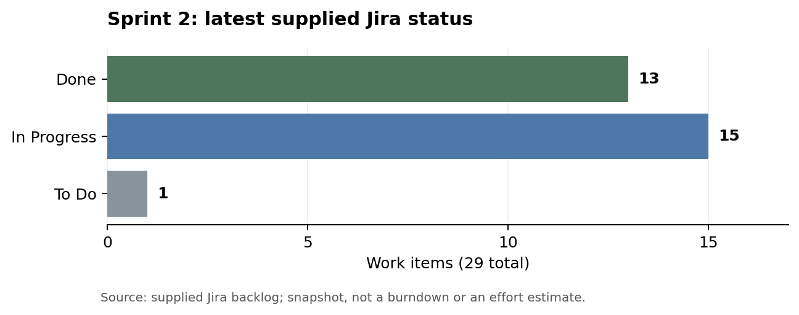
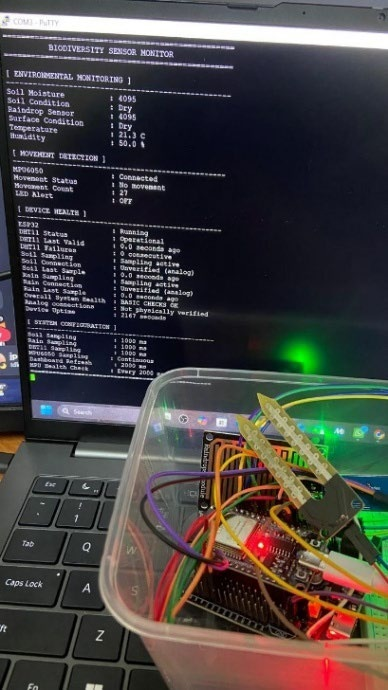
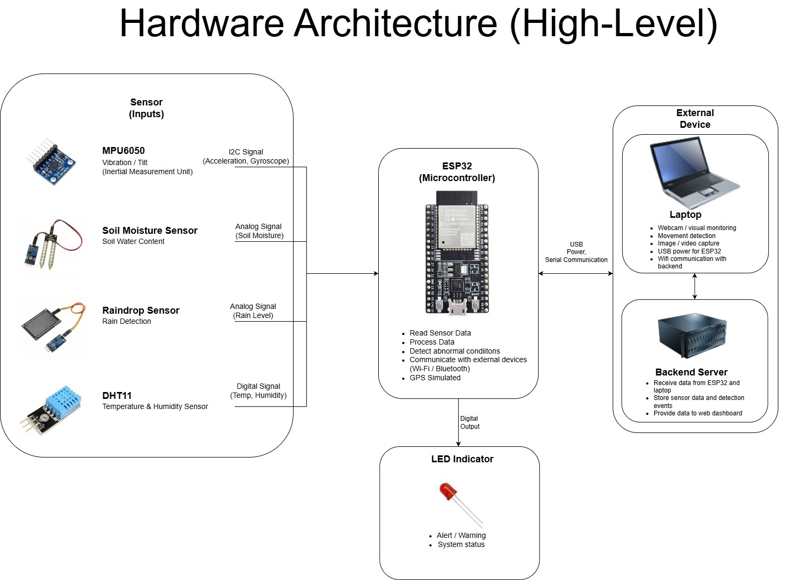
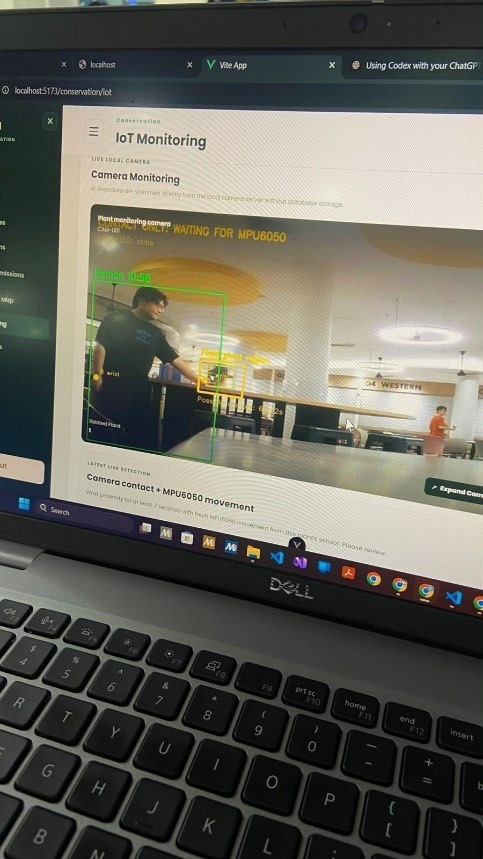
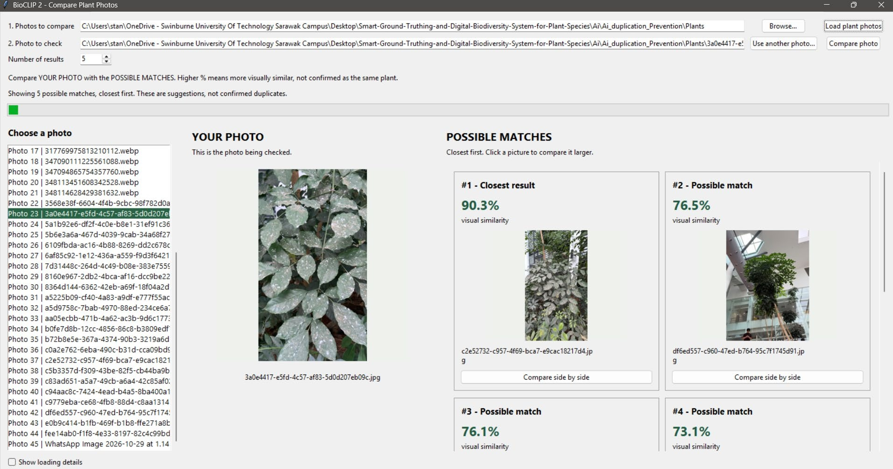
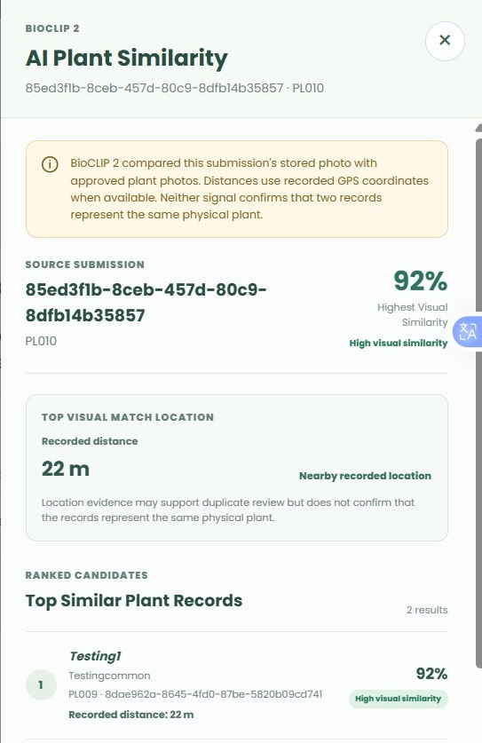
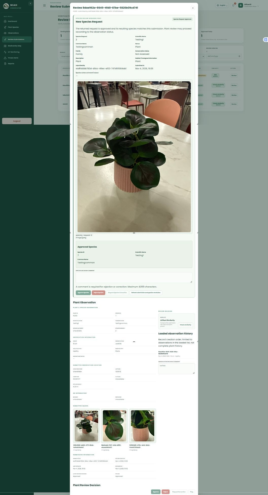

COS30049 COMPUTING TECHNOLOGY INNOVATION PROJECT

Sprint 2 Report

Project Proposal: Smart Ground-Truthing and Digital Biodiversity System for Plant Species Documentation

Group 10

Sprint 2 period: 13 October–5 November 2026

Progress review prepared on 4 November 2026

Group Members:

| Member | Student ID |
|:--|:--|
| Stanton Qi Jin Choo | 104391591 |
| Angie Ang Chyi Yee | 104394710 |
| Jia Sin Ung | 104395250 |
| Jia Ning Chen | 104391287 |
| Jia Xuan Kee | 104395577 |
| Jason Pangestu | 104404033 |
| Yu Xi PHUAN | 104383093 |

# 1. Sprint #2 Plan

## 1.1 Sprint goal

The goal of Sprint 2 was to connect the system prototypes through shared storage and develop the main plant-documentation workflow. The Jira goal, “Complete Database, Intergration and Testing”, covers the mobile application, website, backend services and the database connections needed to exchange records.

Botanists collect plant information, photographs and GPS coordinates. The backend validates and stores the submission. Conservation Officers inspect the evidence, request corrections or approve suitable records. Approved information becomes available according to access permissions. Supporting work includes sensor monitoring, camera alerts, duplicate-candidate retrieval, biometric access, account controls and translation.

The sprint builds on the prototypes described in Sprint 1. Database, cloud and integration work were carried forward because the earlier increment did not demonstrate shared operation. This report records the position on 4 November; it does not claim that the sprint has closed or that every acceptance test is complete.

## 1.2 User roles

| Role | Main responsibility |
|:--|:--|
| Botanist | Register plants, collect field observations and supporting photographs, and submit owned records for review. |
| Conservation Officer | Review scientific records, decide species and plant submissions, inspect monitoring information and respond to alerts. |
| Administrator | Manage accounts, permissions, sensor registration and alert thresholds; scientific approval remains an Officer responsibility. |
| Visitor | Access approved public information and QR-linked educational material within the publication rules. |

*Table 1 – User roles in the integrated workflow.*

The backend enforces these responsibilities independently of interface visibility. Administrator access does not automatically include scientific review. Exact plant coordinates and protected scientific information have narrower access than public species content.

## 1.3 Backlog selection and prioritization

The sprint prioritised the dependencies that prevented shared operation in Sprint 1. Plant submission, database connections, authentication and officer review support the core workflow. Synchronisation and retry handling protect field records when connectivity fails. AI and IoT integration extend this workflow after the applications can exchange persistent data.

Work was organised around business value, component dependencies and a demonstrable result. A functioning screen alone is insufficient for integration: its submission must reach the correct API, survive validation and be retrieved by the intended user. Each module therefore needs a consistent account identity, record identifier and permission boundary.

The latest backlog contains 29 items. Fourteen database, hardware and integration items appear in the supplied scope-change log. Their addition expands the visible sprint scope, but does not by itself establish when the underlying development work began.

## 1.4 Initial Sprint 2 backlog

Table 2 lists the 15 items outside the supplied fourteen-item addition log. It separates the core scope from later additions for readability. Statuses are transcribed from the latest Sprint 2 screenshot, rather than reconstructed as statuses at sprint start. BV scores were not supplied and are not invented.

| Jira | Core backlog item | Current status | Recorded owner |
|:--|:--|:--|:--|
| SCRUM-213 | Implement duplicate plant detection | Done | Stanton |
| SCRUM-22 | Environmental sensor collection | Done | Jason, module lead |
| SCRUM-211 | Implement field-data validation | In Progress | Jia Sin |
| SCRUM-16 | Cloud synchronisation | Done | Angie |
| SCRUM-219 | Conduct functional testing and fix issues | In Progress | Angie |
| SCRUM-218 | Integrate mobile application, backend and database | Done | Jia Ning |
| SCRUM-220 | Demonstrate the completed prototype | In Progress | Unassigned |
| SCRUM-25 | System integration testing | In Progress | Unassigned |
| SCRUM-26 | Usability testing | In Progress | Unassigned |
| SCRUM-34 | Evaluate AI identification performance and field usability | In Progress | Stanton |
| SCRUM-27 | Final integration and testing | In Progress | Unassigned |
| SCRUM-234 | Biometrics | Done | Yu Xi |
| SCRUM-235 | Auto detect prototype | Done | Stanton |
| SCRUM-236 | Account inactivity management | Done | Yu Xi |
| SCRUM-237 | Translation | Done | Angie |

*Table 2 – Core Sprint 2 items and latest visible status.*

These statuses describe the Jira work items. They are considered alongside the inspected code, supplied screenshots and test results; they do not replace system acceptance evidence.

## 1.5 Additional work

The additional work made database responsibilities and hardware integration more explicit. Database configuration, schema investigation, migration and access control became separate items. Camera integration, sensor reliability and AI testing were also separated, allowing completed implementation to be distinguished from unfinished hardware troubleshooting and system-level verification.

| Jira | Additional work | Current status |
|:--|:--|:--|
| SCRUM-238 | PostgreSQL Database Configuration | In Progress |
| SCRUM-239 | Database Schema Investigation | In Progress |
| SCRUM-240 | Database Migration | In Progress |
| SCRUM-241 | Database Permissions and Access Control | In Progress |
| SCRUM-242 | Backend and Supabase Integration | In Progress |
| SCRUM-243 | Database Testing and Troubleshooting | In Progress |
| SCRUM-275 | AI / IoT integration | Done |
| SCRUM-276 | AI External Camera Integration | Done |
| SCRUM-277 | IoT Sensor Monitoring and Device Status Enhancement | In Progress |
| SCRUM-279 | IoT System Testing | Done |
| SCRUM-280 | Hardware Troubleshooting | In Progress |
| SCRUM-281 | Improve ESP32 Serial Data Communication and Reliability | Done |
| SCRUM-282 | AI Detection Troubleshooting | Done |
| SCRUM-283 | AI Integration Testing | To Do |

*Table 3 – Fourteen items listed in the supplied Sprint 2 scope-change log.*

The log records these additions on 4 November. Existing implementation supports several of them, but database and hardware items remain open in the board. Their status is preserved rather than changed to match a general impression of progress.

## 1.6 Task breakdown

Tasks were grouped by the system component and the connection each component provides. Table 4 describes the present implementation and the remaining verification work without assigning unrecorded individual contributions.

| Module | Related items | Implementation and verification tasks | Lead / coordination |
|:--|:--|:--|:--|
| Cybersecurity and access | 234, 236 | Server-backed accounts, password recovery, first-login restrictions, sessions, biometric account linkage and inactivity controls. | Yu Xi |
| Database | 238–243 | Check configured schemas, maintain migrations, verify relational constraints and permissions, and test persistence and recovery. | Jia Xuan |
| Mobile application | 218, 211 | Connect registration, photographs, GPS and QR inventory; retain offline drafts; distinguish the remaining mock observation screen. | Jia Ning, with Jia Sin for validation |
| Website | 219, 25, 26 | Retrieve shared records, persist review decisions, show monitoring information and export supported reports. | Jia Sin and Angie |
| Cloud and synchronisation | 16, 237 | Upload saved drafts, retain failed work, preserve retry identities and provide English/Bahasa Melayu interfaces. | Angie |
| IoT | 22, 276, 277, 279–281 | Sample ESP32 sensors, parse USB serial frames, upload readings and investigate unreliable sensor-status detection. | Jason |
| AI | 213, 235, 275, 282, 283, 34 | Compare stored plant photos, combine wrist proximity with fresh MPU6050 movement and evaluate remaining integration cases. | Stanton |
| Integration and testing | 25–27, 219, 220, 283 | Verify connected workflows, record failures, repeat affected tests and prepare a reproducible demonstration. | Whole group; several Jira items unassigned |

*Table 4 – Task breakdown by module.*

## 1.7 Team responsibilities

| Member | Main work area |
|:--|:--|
| Stanton Qi Jin Choo | Project coordination, BioCLIP duplicate-candidate retrieval and AI/IoT correlation. |
| Jason Pangestu | ESP32 hardware, environmental sensing, external-camera coordination and serial reliability. |
| Jia Ning Chen | Mobile collection, registration and mobile/backend integration. |
| Jia Sin Ung | Officer workflows, website records, validation and biodiversity information. |
| Jia Xuan Kee | PostgreSQL configuration, schema investigation, migration and database permissions. |
| Angie Ang Chyi Yee | Synchronisation, translation, website/backend coordination and functional checks. |
| Yu Xi PHUAN | Account security, biometric integration, recovery and inactivity controls. |

*Table 5 – Team responsibilities carried forward and refined from Sprint 1.*

These responsibilities combine the earlier report, the supplied PDF and readable Jira assignments. They identify module coordination rather than prove authorship of every file. Shared API contracts, test evidence and unresolved dependencies remain responsibilities that require cooperation between members.

# 2. Sprint #2 Review Report

## 2.1 Overall outcome

Sprint 2 has moved the project from separate interface prototypes toward connected application workflows. The code now includes transactional plant registration, persistent review decisions, authenticated sensor ingestion and database-backed account services. BioCLIP comparisons and the local camera stream can be requested through the existing website interfaces.

The latest board marks thirteen items Done, including synchronisation, mobile/backend integration, biometrics and AI/IoT integration. Fifteen items remain In Progress and AI Integration Testing remains To Do. This is a progress review before sprint closure. Local test success and displayed results do not establish complete field acceptance.

## 2.2 Completed and unfinished work

| Work area | Sprint 2 outcome supported by the inspected material |
|:--|:--|
| Plant registration | Add Plant calls an atomic backend submission endpoint containing the plant, first observation, photos, GPS and QR assignment. |
| Officer review | API-backed list/detail loading, revision checks and persisted approval, rejection, flagging and correction decisions are implemented. |
| Species requests | Proposed species remain separate or pending until explicit Officer review; unresolved dependencies block plant approval. |
| Knowledge pages and map | API-backed catalogue, observation and map paths exist. Some Administrator summary values remain static, and the Officer dashboard still loads alerts through the legacy route. |
| Offline synchronisation | FieldCollection saves local drafts and uploads records/photos for review; failed drafts remain available for retry. Jira marks SCRUM-16 Done. |
| Main Add Observation screen | Still calls the local mock-data module. This path cannot be described as shared persistent submission. |
| Database | PostgreSQL connection, migrations and schema-isolation code exist. The six dedicated database items remain In Progress in Jira. |
| Environmental monitoring | Updated ESP32 sketch and serial uploader support the retained sensors and canonical website reading routes. |
| Combined AI/IoT detection | Fixed-region wrist proximity and fresh plant-bound MPU movement are connected in software. Physical failure cases still need recorded acceptance. |
| Camera history and clips | Live camera events are in memory; MP4 clips remain local. Durable camera history and web clip retrieval are not completed by this connection. |
| Duplicate-candidate retrieval | Website requests genuine BioCLIP scores for stored photos. It returns candidates for review rather than automatically confirming a duplicate. |
| Security and language | Server accounts, recovery, biometric linkage, inactivity policy and English/Bahasa Melayu support are implemented. |
| Final verification | Functional, integration, usability and AI-performance work remain open in the latest board. |

*Table 6 – Sprint 2 implementation outcomes and outstanding work.*

Compared with Sprint 1, account handling is no longer described only as browser-local prototype behaviour. The backend checks account status, sessions and permissions. Scientific approval and administration remain separate. Plant and sensor services also provide persistent routes rather than relying exclusively on demonstration data.

Integration is not uniform across every screen. The field-collection synchronisation path and online Add Plant submission are implemented, while Add Observation still writes into an in-memory array. Similarly, the canonical threat-alert workflow persists sensor alerts, but its separate camera prototype panel must not be treated as durable live-camera history.

## 2.3 Cloud and database integration challenges

Database implementation was delayed in Sprint 1, so part of this work was carried forward to Sprint 2. The delay affected integration between dependent modules. Shared-storage functions have since progressed, but database configuration, migration, permissions and testing remain In Progress in the current Jira backlog.

The main infrastructure change is the use of PostgreSQL-backed services for shared operation. Plant, account and biometric data use configured schemas and distinct access paths. Reviewed migrations establish the relationships needed by submissions, media, requests, devices and record history.

Cloudflare provides a temporary HTTPS route from the phone to services running on the development computer. It is a connectivity tool, not the database or an offline queue. The website normally reads the shared backend directly; offline mobile drafts require their separate upload process before another client can retrieve them.

| Challenge | Current effect | Required response |
|:--|:--|:--|
| Multiple schemas and legacy tables | A working query against one schema does not prove another module uses the same records. | Verify configured search paths, foreign keys and canonical routes; retain migration evidence. |
| Changing tunnel hostname | A phone can continue calling an expired gateway address. | Update the active mobile backend URL and restart Expo with a cleared cache. |
| Separate runtime processes | Website login, plant APIs, face recognition, camera and BioCLIP have different startup needs. | Keep an explicit service checklist and verify each required health endpoint. |
| Remaining mock workflow | Add Observation can show local success without shared persistence. | Connect that screen to the persistent workflow and test retrieval after restart. |
| Sensor health and calibration | Fresh serial output may contain retained values or uncertain hardware status. | Validate physical disconnect behaviour and calibrate the actual probes. |

*Table 7 – Integration challenges and remaining responses.*

Database tasks remain open even though connection and migration code are present. The group still needs deployment-specific evidence for schema compatibility, permissions and operational recovery. No production database migration, permission change or hardware modification was performed while preparing this report.

## 2.4 System improvement decision

The two AI improvements identified in Sprint 1 now have clearer implementation boundaries. Duplicate detection retrieves visually similar stored plant records for Officer review. Monitoring combines camera wrist proximity with movement reported by the MPU6050 assigned to the same plant, rather than treating a detected person as a confirmed threat.

| Improvement | Current implemented behaviour |
|:--|:--|
| AI-assisted duplicate plant review | Compare a submission photo with approved reference plants and show ranked IDs, species, cosine similarity and available GPS distance. |
| AI-assisted plant monitoring | Require sustained wrist proximity in a selected plant region and a fresh, connected, plant-bound MPU6050 movement reading before a combined alert. |

*Table 8 – Implemented improvement boundaries.*

A high visual score is not proof that two records refer to the same specimen. Different plants of the same species can look similar. Recorded distance adds context but depends on GPS quality. The system therefore leaves approval and duplicate interpretation with the Conservation Officer.

The combined monitoring rule also provides supporting evidence rather than a legal or biological conclusion. A hand near a selected region and sensor movement may indicate handling, but authorised maintenance can produce the same signals. Recorded evaluation must include normal activity, missed wrists, stale uploads, sensor failures and camera movement.

## 2.5 Burndown analysis

The corrected screenshot identifies SCRUM Sprint 2, dated 13 October–5 November 2026, with work-item count as its estimation field. This replaces the earlier image that was labelled Sprint 1. The discussion below uses the corrected report and the current backlog rather than inventing daily completion values.

The remaining-work line begins at about fifteen items and stays level for much of the displayed period. It then falls to approximately twelve before rising near the review date. These changes describe the count tracked by Jira, not a measured rate of coding effort or elapsed development time.

The scope-change log lists fourteen additions on 4 November. It reports a revised commitment of twenty-nine items. Late additions help explain the upward movement, but the chart image does not supply a complete numerical daily history. A smooth replacement burndown or a retrospective estimate of story points would therefore be misleading.

| Latest status | Items | Jira keys |
|:--|:--|:--|
| Done | 13 | SCRUM-16, 22, 213, 218, 234, 235, 236, 237, 275, 276, 279, 281, 282 |
| In Progress | 15 | SCRUM-25, 26, 27, 34, 211, 219, 220, 238, 239, 240, 241, 242, 243, 277, 280 |
| To Do | 1 | SCRUM-283 |
| Total | 29 | All items visible in the latest Sprint 2 backlog. |

*Table 9 – Current Sprint 2 status from the supplied Jira screenshots.*

Thirteen of twenty-nine items are Done, or approximately 44.8% by item count. Sixteen are not Done. This percentage does not measure completed engineering effort because items differ in size. It also does not certify that broad integration work has passed every required failure case or usability check.

The chart's right-hand remaining-work value is not reconciled directly with the sixteen non-Done items in the displayed status lists. The screenshots do not expose enough issue history to explain that difference. The report preserves both observations, uses the tables for the current status count and makes no unsupported claim that the sprint reached zero remaining work.

*Figure 1 – Status summary derived from the supplied backlog: 13 Done, 15 In Progress and 1 To Do. This is a status chart, not a reconstructed burndown.*

## 2.6 Review decision

Sprint 2 demonstrates substantial progress beyond standalone prototypes, but the whole increment should remain under review. The next acceptance decision depends on completing the remaining database, hardware, integration and usability checks and resolving the screens that still use demonstration data.

# 3. Sprint #2 Retrospective Report

This retrospective reflects the inspected code, the latest Jira snapshot and supplied project evidence. It identifies practical lessons and proposed follow-up actions; it does not assert that a final retrospective meeting or stakeholder sign-off has already taken place.

## 3.1 What went well

Shared API contracts made several previously separate interfaces work against persistent records. Atomic plant submission, protected media and revision-controlled review provide a clearer path from mobile collection to officer decision. Automated tests cover retries, malformed responses and permission boundaries.

The AI improvements now have specific conditions. BioCLIP returns ranked candidates with real record identities, while the camera requires both wrist proximity and fresh movement from the assigned sensor. These conditions are easier to explain and test than general claims of automatic threat detection.

The hardware work simplified the prototype by retaining the sensors needed for the present monitoring goal. The supplied PDF documents experiments, serial output and unresolved status problems. Recording those limitations supports useful handover instead of presenting every visible reading as a calibrated, fully reliable measurement.

## 3.2 What could be improved

The sprint still contains broad integration and testing items that remain unfinished near the review date. Added database and hardware work also increased scope. These conditions show the need for smaller acceptance units and clearer evidence of operational readiness.

Integration should cover the actual paths used by demonstrators. A persistent API or a separate field screen does not automatically replace every prototype route. Add Observation still uses mock records, and the camera panel contains non-persistent events. Demonstration instructions should identify these paths before the group describes a complete user workflow.

Task completion and system acceptance need separate evidence. Jira marks AI/IoT integration and sensor testing Done, but AI Integration Testing is To Do and hardware troubleshooting remains In Progress. Each completed item should state the implemented boundary, its test evidence and any broader checks that belong to another item.

Work-item counts need consistent interpretation. Fourteen later additions expanded the recorded commitment, while the chart endpoint does not match the current non-Done list. Updating scope and statuses promptly, and retaining an issue export, would make the final review easier to reconcile and prevent unsupported progress claims.

Hardware health needs more explicit treatment. The inspected sketch retains previous successful DHT readings and reports MPU readiness established at startup. This does not establish continuous detection of a later physical disconnection. Firmware health, upload freshness and camera gating must be evaluated together rather than assumed equivalent.

## 3.3 Actions following Sprint 2

| Improvement | Proposed follow-up action |
|:--|:--|
| Complete visible workflows | Replace the remaining mock observation path and verify retrieval after restarting the application. |
| Clarify acceptance | Record expected result, actual result, evidence and limits for each broad integration item. |
| Verify database readiness | Complete the open configuration, migration, permission and troubleshooting tasks with deployment-specific checks. |
| Validate physical sensing | Test runtime disconnects, calibrate probes and distinguish retained readings from fresh measurements. |
| Preserve camera evidence | Define whether durable camera events and website clip playback are required; implement and test them if included. |
| Evaluate AI performance | Label individual specimens, include lookalike plants and measure retrieval quality and false alerts. |
| Reconcile Jira | Export issue history and confirm the burndown/status discrepancy before final submission. |
| Improve reproducibility | Maintain startup commands, configuration guidance and a repeatable demonstration checklist. |

*Table 10 – Proposed process and acceptance improvements.*

## 3.4 Next increment goal

The next increment should establish reliable connected behaviour across the remaining paths, rather than adding more interface breadth. Priority should go to unfinished database work, persistent observation submission, physical sensor health, AI integration testing and the final demonstration of authorised collection, review and publication.

Acceptance should follow complete user scenarios. A Botanist saves or uploads a record, the Officer retrieves the same evidence, a decision persists, and publication follows permissions. Separate scenarios should prove offline recovery, failed retries, sensor freshness and camera limitations. These checks should produce recorded results that another group member can reproduce.

| Acceptance area | Required observable result |
|:--|:--|
| Persistent field workflow | The same plant, photos and decision remain accessible after client and backend restart. |
| Offline recovery | Saved drafts survive restart, retain ownership and upload once without losing newer edits. |
| Monitoring | Stationary, moving, stale and unavailable sensor states produce the expected camera behaviour. |
| AI review | Genuine results retain the correct plant IDs; missing data and model failures cannot produce demo scores. |
| Access and publication | Unauthorised roles cannot review protected evidence or publish pending records. |

*Table 11 – Acceptance outcomes for the next increment.*

The final handover should include reproducible commands, recorded results and a clearly scoped defect list. Tests and screenshots should support each claim without being described as field accuracy, user acceptance or production readiness when those evaluations have not occurred.

# 4. Sprint #2 Deliverables

## 4.1 Sprint 2 deliverables

The main deliverables are the connected services and workflows developed from the earlier prototypes. They include persistent plant registration and review, offline draft upload, shared monitoring routes, account controls and the website connections for BioCLIP and the local AI camera.

Supporting deliverables include schema migrations, tests, runtime scripts and evidence supplied in the PDF. These materials explain what the implementation does and how to reproduce it. The detailed technical companion identifies source files, API contracts, limits and outstanding acceptance checks without exposing private environment values or provisioning keys.

| Deliverable | Description | Relevance to the project |
|:--|:--|:--|
| Transactional registration | One validated submission stores the plant, observation, photos, GPS and QR assignment. | Reduces partial saves and duplicate retries. |
| Persistent review workflow | Officer decisions use authoritative IDs, revisions and server readback. | Keeps review decisions consistent with shared records. |
| Offline draft synchronisation | Local drafts upload records and assets and remain available after failed requests. | Supports interrupted field connectivity. |
| PostgreSQL integration code | Scoped connections and reviewed migrations for domain, account and face data. | Establishes shared persistence while retaining access separation. |
| ESP32 sensor prototype | DHT11, soil, rain and MPU6050 sensing with local LED indication. | Supports environmental and movement monitoring. |
| Serial ingestion bridge | Parser, durable SQLite outbox, authenticated upload and stable retry identities. | Connects the USB kit to the plant backend. |
| Combined AI/IoT monitor | Wrist-region timing with fresh sensor movement, local stream and event display. | Supports review of possible plant handling. |
| BioCLIP website connection | On-demand stored-photo ranking with IDs, species, similarity and available distance. | Helps Officers inspect possible duplicate records. |
| Security and language functions | Server accounts, recovery, logout, biometric linkage, inactivity and bilingual interfaces. | Supports controlled, usable access. |
| Verification material | Automated checks, supplied hardware images and website screenshots. | Documents evidence and remaining acceptance limits. |
| Sprint 2 documentation | This report and its detailed technical companion. | Provides traceability and handover across the project. |

*Table 12 – Sprint 2 deliverables and project relevance.*

## 4.2 Cybersecurity and account integration

The cybersecurity deliverable extends the Sprint 1 account prototypes into server-backed workflows. Current code supports account provisioning, temporary-password restrictions, permanent password changes, recovery, session validation and logout. Biometric requests use an account adapter rather than creating an independent authority over user roles. The latest board marks biometrics and inactivity management Done.

### Account creation and temporary-password email

The Administrator provisions staff accounts through the server workflow. Temporary credentials require a password change before protected operations become available. Current password creation uses salted scrypt hashes, replacing the earlier proposed bcrypt description. Delivery depends on configured email services; a successful request is not treated as proof that a message reached the recipient. Account status and role checks continue after login.

| Function | Sprint 2 implementation | Evidence boundary |
|:--|:--|:--|
| Provision staff | Server-side account creation and temporary-password state. | Tested with isolated account stores and HTTP boundaries. |
| Store credentials | Salted scrypt for current passwords; stored hashes rather than plaintext. | Does not imply all historical data or all personal fields are encrypted. |
| First login | Restrict protected access until the required password change succeeds. | Client navigation alone cannot remove the server restriction. |
| Email delivery | Server configuration and sanitised provider failure handling. | Real mailbox delivery remains environment-dependent. |
| Account inactivity | Thirty-day policy, session revocation and administrator reactivation. | Checks use server timestamps; final activated Administrator is protected from lockout. |

*Table 13 – Account provisioning and lifecycle functions.*

The inactivity policy considers successful account activity and relevant server audit timestamps. Qualifying active accounts are suspended and their sessions removed. Reactivation starts a fresh policy window without reviving revoked sessions. Temporary-password and legacy account states are handled separately. The code also protects the last fully activated Administrator, reducing the risk of making recovery administration unavailable.

### Forgot password and OTP recovery

Recovery has moved from a browser-local demonstration to server-managed verification. The server generates a six-digit code, stores an HMAC-derived value and applies a five-minute expiry. Requests and attempts are bounded, and codes are single use. A successful reset updates the password and invalidates old access. This supersedes the twenty-second OTP duration documented for the Sprint 1 prototype.

The initial response deliberately does not confirm whether an eligible account exists or whether delivery completed. Email-provider failures are recorded through controlled categories. Reset confirmation verifies the recovery identifier, code, password constraints and account eligibility. The implementation can be tested without sending real email, but that does not establish mailbox delivery in the current demonstration environment.

### Logout and biometric access

Logout ends server-side access and clears the mobile session state. The face service uses private account-service operations to obtain authoritative identity and permissions after recognition. PostgreSQL face storage is separate from account and plant schemas. A detected face, loaded model or successful HTTP challenge alone is not evidence of a completed genuine-user login.

| Component | Sprint 2 role |
|:--|:--|
| Vue website | Account administration, login, recovery and protected Officer interfaces. |
| Expo mobile app | Verified account state, token storage, biometric interaction and bounded offline draft access. |
| Node account service | Password verification, session lifecycle, role/status authority and recovery. |
| Python face service | Face processing and signed linkage to authoritative account operations. |
| PostgreSQL schemas | Persistent account and biometric data with separate configured access. |

*Table 14 – Components involved in account and biometric access.*

Selected account tests passed for recovery, status changes, first-login restrictions and signed service requests. These software results support the implementation claims. Biometric false acceptance, genuine-user completion and field usability still require a documented device-level evaluation.

| Tool / technology | Function in Sprint 2 |
|:--|:--|
| Node crypto | Current password hashing, token generation, recovery-code hashing and constant-time comparisons. |
| PostgreSQL | Persistent accounts, sessions, audit events and recovery state. |
| EmailJS integration | Configured account and OTP delivery through the server. |
| Python face runtime | Recognition processing and the account-adapter connection. |
| Shared RBAC module | Explicit role permissions, ownership constraints and exact-GPS projection. |
| i18next / vue-i18n | English and Bahasa Melayu interface labels without altering canonical record values. |

*Table 15 – Account, permission and language technologies.*

Translation is an interface function rather than automatic translation of scientific content. Language preferences persist locally, missing translations fall back to English, and controlled values are translated for display. Names, notes, identifiers and stored decision values must retain their original meaning.

## 4.3 IoT sensor-node integration

The IoT work refined the ESP32 prototype and connected its serial output to the backend. The supplied PDF records removal of the sound sensor and LCD. The inspected sketch matches the retained DHT11, soil moisture, raindrop and MPU6050 components, with an LED for movement indication. Soil and rain values remain raw readings.

| Sensor / device | Current purpose | Connection in the inspected sketch |
|:--|:--|:--|
| DHT11 | Temperature and relative humidity. | GPIO4. |
| Soil moisture probe | Raw analogue reading and configured condition label. | GPIO35. |
| Raindrop sensor | Raw analogue reading and configured surface condition. | GPIO34. |
| MPU6050 | Acceleration/rotation-based movement state. | I2C SDA21 and SCL22. |
| LED | Local movement indication. | GPIO5. |
| ESP32 USB serial | Transfer dashboard frames to the laptop. | 115200 baud. |

*Table 16 – Current sensors and local communication.*

The current path is ESP32 to laptop over USB serial, then the Python bridge to the backend over HTTP on the same computer or HTTPS remotely. Complete frames enter a private SQLite outbox before upload. Device authentication, stable client keys and ingestion receipts protect retries. Capture timestamps and explicit reported MPU health are retained, so delayed uploads remain historical evidence instead of becoming fresh movement signals. A completed Wi-Fi or MQTT ingestion path is not asserted.

*Figure 2 – Updated ESP32 prototype and serial-monitor evidence from the supplied PDF, page 5. This documents the team's hardware demonstration, not a new measurement made during report preparation.*

The firmware checks movement against acceleration and rotation thresholds and uses a quiet period to end an event. Its startup calibration samples are present, but the inspected movement calculation compares acceleration magnitude with gravity rather than applying the recorded axis baselines. Threshold settings therefore remain implementation parameters that require physical evaluation, not validated detection accuracy.

*Figure 3 – Hardware architecture supplied in the PDF, page 7. The current code sends USB serial readings through the laptop uploader.*

The PDF describes resistor experiments and difficulties identifying soil and rain sensor failures. Those limitations remain relevant. The inspected sketch also retains the last valid DHT result and establishes MPU readiness during setup. Freshly uploaded frames therefore cannot by themselves prove that every included sensor remained healthy at capture time.

## 4.4 AI implementations

The AI deliverables extend both Sprint 1 prototypes. The camera monitor combines human detection, plant boxes and wrist pose with plant-bound MPU6050 state. BioCLIP 2 replaces the generic image-grouping demonstration with ranked visual candidates and a website connection. Both models run on the laptop; no project-specific model training is evidenced.

### Human detection and plant contact monitor

The camera reads live frames and runs human/animal detection, plant detection and wrist pose estimation. A user fixes the monitored plant region using P or a mouse drag in the desktop window. The combined rule requires a confident wrist near that region for at least two seconds and fresh movement from the active Sensor assigned to the same database plant. Person presence, wrist proximity alone or sensor movement alone does not satisfy this rule. Model track IDs describe tracked detections rather than database plant identities or real-world personal identities.

*Figure 4 – Camera feed displayed in the website, supplied PDF page 9. The image supports interface connectivity; it does not establish measured frame rate or detection accuracy.*

The backend movement endpoint verifies the device key, Sensor type and plant assignment. Samples older than five seconds, uncertain MPU health and unavailable services cannot open the gate. The camera also expires cached state. This replaces video-based plant movement as the condition for combined alerts.

Qualifying activity publishes a local event and starts an MP4 recording. The normal recording tail is five seconds after qualifying contact ends; stale or unavailable sensor state ends recording immediately. New clips use a 640-by-360 scene, while playback timing is managed independently of variable inference speed. Repeated frames preserve timing but do not recover missed visual detail. The local HTTP service publishes annotated frames and up to one hundred memory-held events for the website. These events reset when the process restarts, and clips remain local files rather than database-backed video history. Browser region selection and permanent camera hosting are not part of this connection. SCRUM-283 remains To Do, so the complete physical integration should not be described as accepted.

### Duplicate plant photo detection

BioCLIP 2 uses pretrained image embeddings to compare a query photo with reference images. The desktop GUI still supports folder-based exploration, while the website now uses stored database photos. The backend selects one photo per other approved plant, preferring the whole-plant image from its latest approved observation. Approved reference assets and species visibility are checked before inference. The current request compares at most fifty reference plants, in plant-ID order, and returns the five highest-ranked candidates.

*Figure 5 – Desktop BioCLIP retrieval example supplied in the PDF, page 10. Displayed scores are example similarities, not measured accuracy.*

The website drawer shows actual plant and observation identifiers, available species names, cosine similarity and distance calculated from valid recorded coordinates. Missing coordinates remain unavailable. The same plant is excluded from its own candidate gallery. Model failures or malformed results produce errors rather than prototype scores, and Officer review remains independent of the ranking.

*Figure 6 – Website BioCLIP result supplied in the PDF, page 16. The displayed 92% score and 22 m distance describe this example; they are not an evaluated accuracy rate or proof of a duplicate specimen.*

Unlike the Sprint 1 threshold-grouping tool, this route performs candidate retrieval on demand. It does not train a specimen classifier, merge records, reject submissions automatically or save an analysis decision. Evaluation should include the same specimen from different views and different specimens of the same species. SCRUM-34 remains In Progress.

## 4.5 Deliverable limitations and handover

The deliverables establish connected software behaviour, supported by tests and supplied screenshots. They do not establish complete field deployment. Remaining limits include the mock observation screen, static dashboard summaries, legacy alert aggregation, unfinished database tasks, uncertain sensor-health detection, local-only clips, memory-held camera events and incomplete AI/usability evaluation.

The handover should preserve these boundaries alongside the working functions. The team should demonstrate a real mobile record reaching Officer review, verify offline recovery and controlled physical sensor cases, and record permission failures. Final acceptance should be based on these results rather than the existence of a screen, a stored filename or a Done label alone.

## 4.6 Evidence

Evidence consists of the Sprint 1 baseline, the supplied Sprint 2 PDF, the corrected Jira screenshots and the current workspace. The latest Jira evidence takes precedence over earlier screenshots. Source inspection identifies implementation behaviour; automated checks exercise controlled fixtures; supplied images document the team's displayed results.

| Check | Result | Evidence boundary |
|:--|:--|:--|
| Plant backend suite | 155 cases: initial run 153 passed; two subprocess checks passed in a targeted rerun. | The rerun contained 21 overlapping cases, all passed. Do not add those 21 to 155. |
| Website review, IoT, alerts and reports | 50 passed. | Actual component/service logic with controlled HTTP boundaries; no production records changed. |
| Mobile registration, draft sync, recovery, language and session checks | 45 passed. | Controlled logic/render checks; not a physical phone acceptance session. |
| Account inactivity, authentication, activation, recovery and face adapter | 29 passed. | Account-policy and signed-service behaviour; no biometric accuracy measurement. |
| Camera contact, HTTP publication and MPU client | 18 passed. | Controlled frames, states and HTTP checks; not measured physical detection performance. |
| Serial bridge | 24 passed outside the sandbox. | Parser, outbox, retry and USB boundary tests; no kit flashing or calibration. |
| BioCLIP engine | 4 passed during the integration work in this session. | Ranking, cache invalidation and malformed-feature checks. |
| Website type check and production build | Passed during the integration work in this session. | Build warning about bundle size remains; build success is not usability acceptance. |
| Real BioCLIP protocol check | Passed against the running local model using synthetic images. | Confirms inference connectivity and score format, not plant-recognition accuracy. |

*Table 17 – Verification available at report preparation, 4 November 2026.*

The initial backend subprocess failures and serial temporary-folder failures were caused by the execution sandbox; the affected checks passed when rerun with appropriate access. Earlier report drafts recorded other integration failures, but those results are superseded by the current checks. Passing isolated fixtures does not certify the live database configuration.

*Figure 7 – Observation review evidence supplied in the PDF, page 17. It shows the review interface and photographs without establishing the outcome of every failure scenario.*

The detailed technical documentation accompanies this report with source references, API contracts, startup guidance and outstanding acceptance scenarios. The group should retain the original Jira screenshots and supplied PDF alongside the test results. Together, these records allow a reviewer to distinguish completed implementation, demonstrated examples and work that remains under verification.
